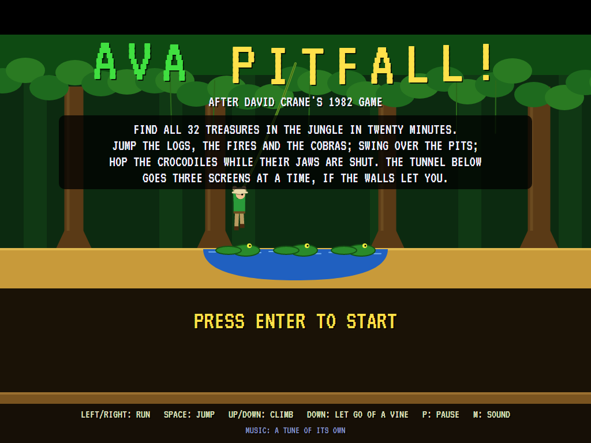
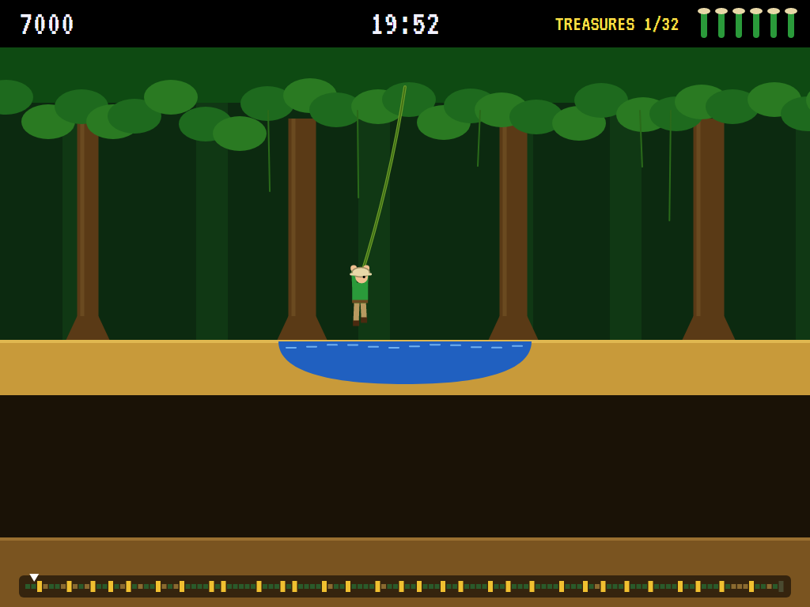
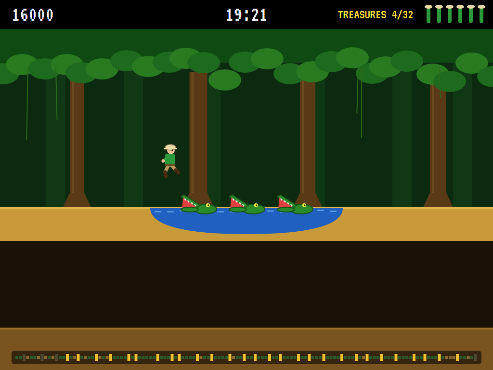
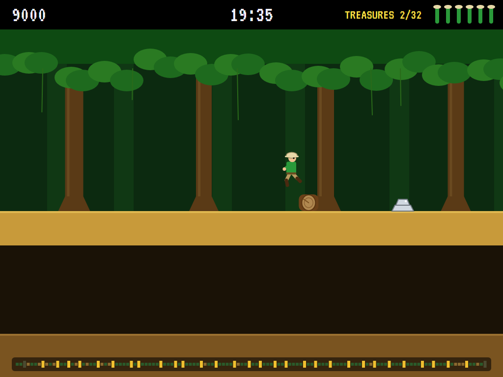
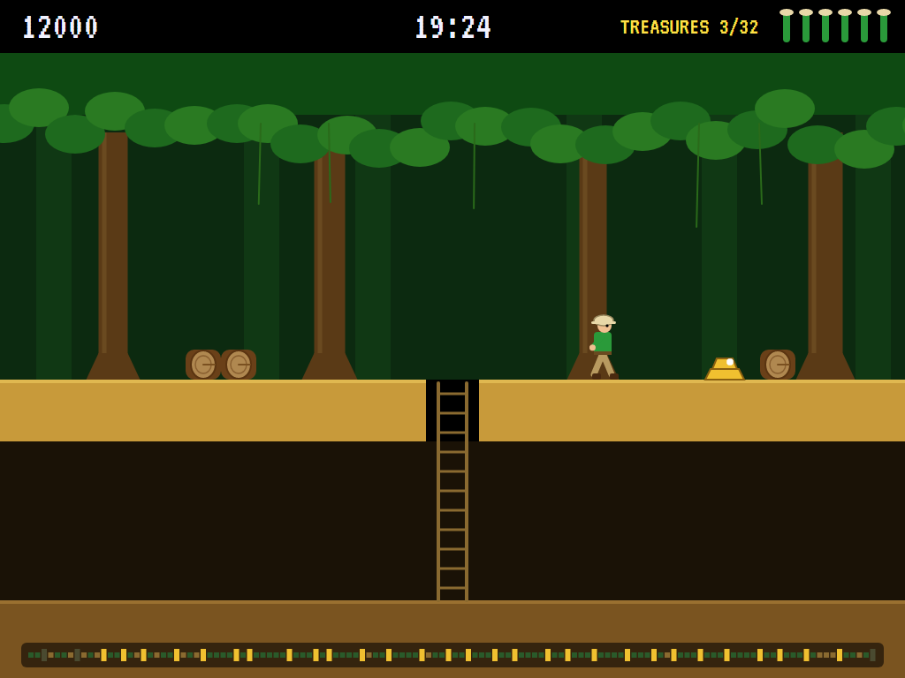
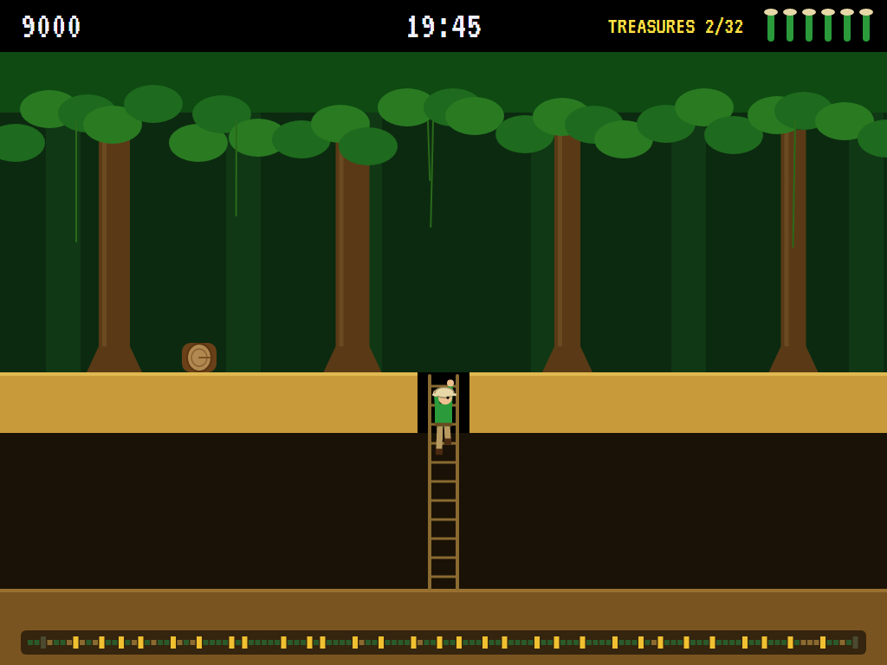
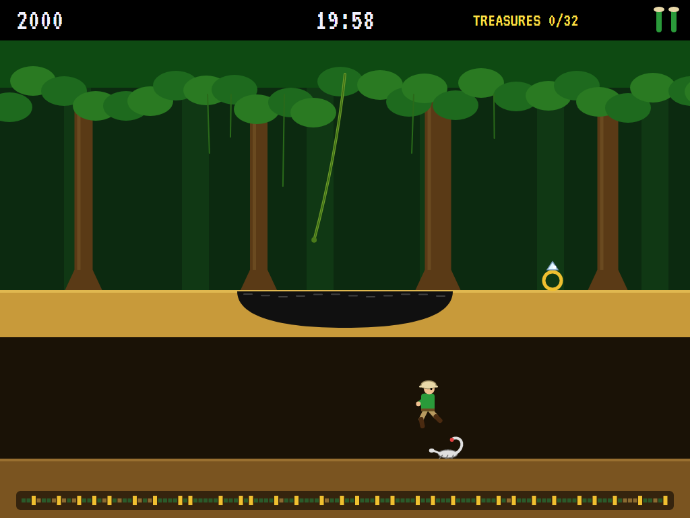
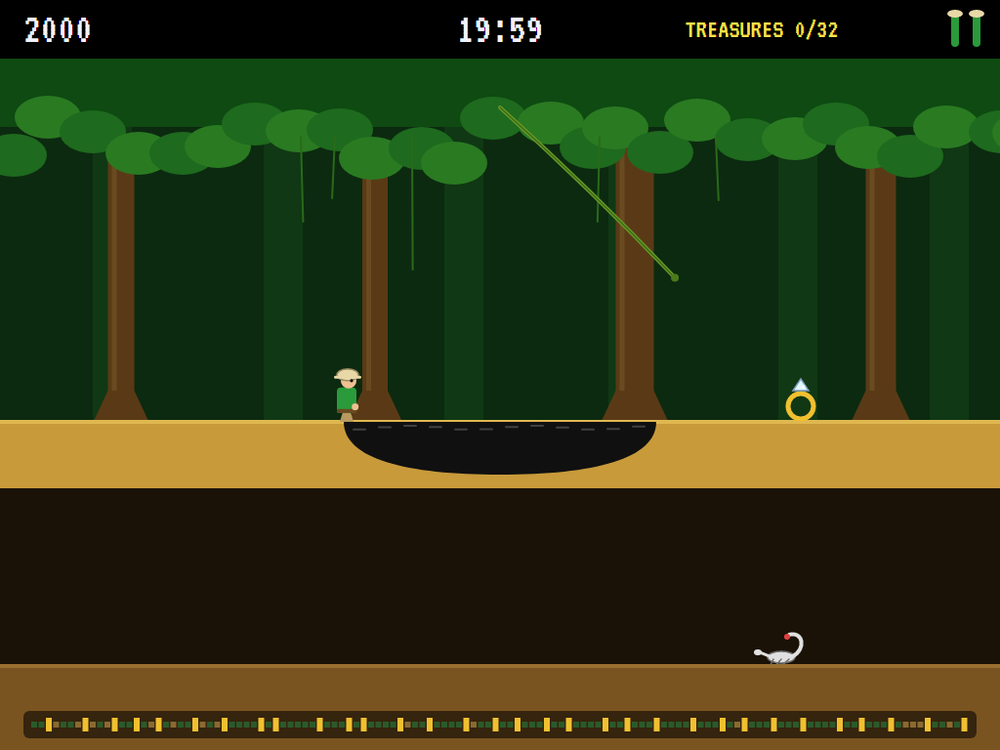
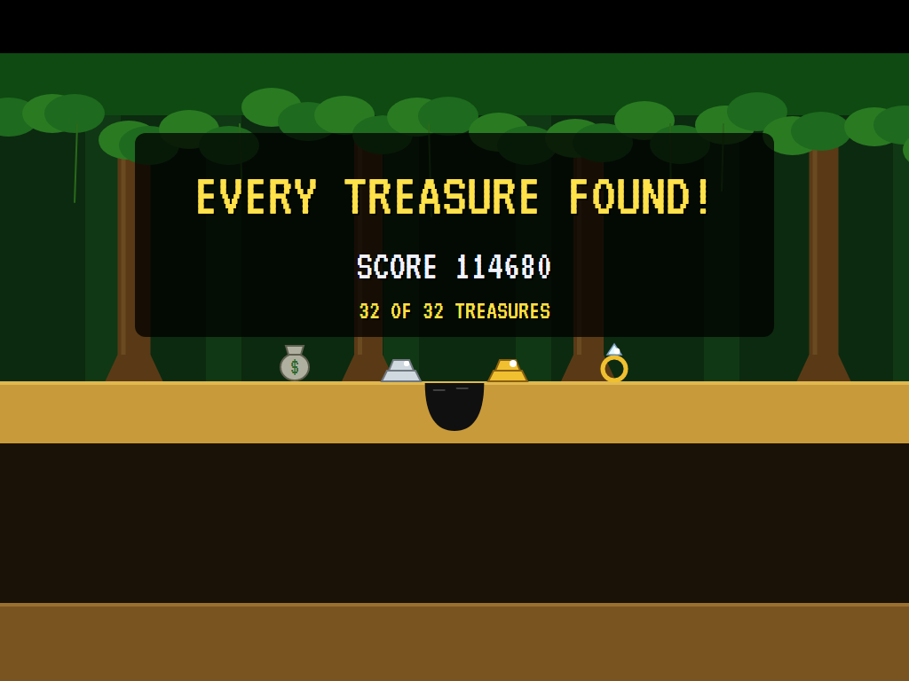

# AVA Pitfall!

[](https://github.com/Harlock123/AVAPitfall/actions/workflows/build.yml)

A jungle adventure in the style of David Crane's 1982 Activision game **Pitfall!**, built with .NET 10 and
Avalonia UI. Pitfall Harry has twenty minutes to find all 32 treasures in the jungle. Jump the logs, the
fires and the cobras, swing over the pits, hop the crocodiles while their jaws are shut, and take the tunnel
underneath to travel three screens at a time.

## Features

- **A jungle of 128 screens** in a ring, built from a seed the way the original was built from a shift
  register. Each screen has its pit or holes, its logs, its vine, its crocodiles, and its treasure or danger,
  with its own stretch of tunnel underneath.
- **Pits** of tar, quicksand and water. Every one has a way across: it opens and shuts, or a vine hangs over
  it, or crocodiles lie in the water whose heads you can stand on while their jaws are shut. Holes in the
  path drop you into the tunnel for a hundred points; some have ladders.
- **The tunnel** goes three screens of jungle for every one of its own, until a brick wall blocks the way.
  A scorpion comes after you along the floor.
- **Logs** lie in pairs or roll at you; each one you bump into costs a hundred points. Fires and cobras are
  the end of Harry. There are four kinds of treasure: money bags (2,000), silver bars (3,000), gold bars
  (4,000) and diamond rings (5,000). Find all 32 from your starting 2,000 and you have 114,000, plus ten
  points for every second to spare.
- **The jump** is a fixed arc, as it was: a running jump goes 180 dots, a standing one goes straight up.
  Swing from the vine and let go with the speed of the swing. Harry yells as he catches it.
- **Three lives.** Lose one and Harry drops back in at the end of the screen he came in by.
- **A map strip** along the bottom shows the ring of screens: where Harry is, the ladders, and the treasures
  still to find.
- **The attract mode** shows the computer Harry at work. It plans its way round the jungle like a map: across
  screens, down ladders and holes, three screens at a time through the tunnel where the walls allow, always to
  the nearest treasure left. On each screen it plays the crossing out on a copy of the jungle before it
  commits. It runs for it, jumps now, or waits at the edge (jumping any log that comes) until the
  crocodiles' jaws, the pit or the vine are right.

## Screenshots

| The title | Swinging | Crocodiles |
|:---------:|:--------:|:----------:|
|  |  |  |
| | Over the pit on the vine. | Their jaws are open: wait. |

| Logs | A treasure | Into the tunnel |
|:----:|:----------:|:---------------:|
|  |  |  |
| Jumping a rolling log. | A gold bar. | Down the ladder. |

| The scorpion | The tar pit | Every treasure |
|:------------:|:-----------:|:--------------:|
|  |  |  |
| Over it in the tunnel. | Too late. | |

The screenshots are made by the tests, which play the game in a real (headless) window; see
[Tests](#tests).

## Download and run

Ready-to-run builds for Windows, macOS and Linux, on both Intel/AMD and ARM, are on the
[Releases page](https://github.com/Harlock123/AVAPitfall/releases/tag/latest). **Latest build** is
rebuilt on every push to `main`. Each download is one self-contained executable: no .NET install is
needed.

| Platform | Archive |
|---|---|
| Windows | `AVAPitfall-win-x64.zip`, `AVAPitfall-win-x86.zip`, `AVAPitfall-win-arm64.zip` |
| macOS | `AVAPitfall-osx-arm64.tar.gz` (Apple silicon), `AVAPitfall-osx-x64.tar.gz` (Intel) |
| Linux | `AVAPitfall-linux-x64.tar.gz`, `AVAPitfall-linux-arm64.tar.gz`, `AVAPitfall-linux-arm.tar.gz` |

```bash
tar -xzf AVAPitfall-linux-x64.tar.gz     # or linux-arm64, linux-arm, osx-arm64, osx-x64
./AVAPitfall
```

On Windows, unzip and run `AVAPitfall.exe`. On macOS, if Gatekeeper refuses to open it, run
`xattr -d com.apple.quarantine AVAPitfall` once. Run with `--no-audio` for silence.

**Sound** comes through OpenAL Soft, built in for every platform. In a virtual machine the game
detects it and uses a larger audio buffer, so the sound doesn't break up.

**Gamepads** use SDL2, which is bundled for Windows, macOS and Intel/AMD Linux. ARM Linux builds need it
installed; without it the keyboard still works:

```bash
sudo apt install libsdl2-dev            # Debian / Ubuntu / Raspberry Pi OS
sudo pacman -S --needed sdl2-compat     # Arch / Omarchy
```

## Controls

| Action | Keyboard | Gamepad |
|---|---|---|
| Start | Enter or 1 | Start |
| Run | Left/right arrows, or A/D | Left stick / D-pad |
| Climb a ladder | Up/down arrows, or W/S | Up / down |
| Jump | Space, Z, X or Ctrl | A or B |
| Let go of the vine | Down (or jump) | Down |
| Pause | P or Esc | Start |
| Sound on/off | M | |
| Screenshot | Ctrl+S (to your Pictures folder) | |

On the high-score table, type your initials, or use up/down and Space, then Enter.

## Tests

```bash
dotnet test AVAPitfall.slnx
```

The game runs in fixed 60 Hz steps, so it plays the same at any frame rate. Everything that changes lives in
one world that can be copied; the logs, crocodiles, pits and vines go by the clock. The tests check:

- **The jungle:** the same from the same seed; 32 treasures on different screens, worth 114,000 with the
  starting 2,000; a way across every deadly pit; no logs by the holes.
- **Running and jumping:** the running speed and the fixed jump; off the edge to the next screen, and three
  on in the tunnel; a hole into the tunnel for a hundred points; three holes cleared from their edges.
- **Pits, crocodiles and the vine:** tar swallowing Harry; a shifting pit opening and shutting, and crossed
  shut; a crocodile's head safe while its jaws are shut and not after; catching the vine and letting go
  beyond the pit.
- **The tunnel:** down the ladder and up again, hopping off clear of the hole; a brick wall; the
  scorpion, coming for Harry and jumped.
- **Logs, dangers and treasure:** a hundred points a bump; rolling logs rolling; a fire; a treasure scored.
- **The game:** three lives, back where Harry came in; twenty minutes; every treasure found, the time
  counted in, and initials; the demonstration and high scores; pause; a copied world; the keys.
- **The computer Harry:** every treasure found inside twelve minutes without a life lost; just running and
  jumping finds none.

`tests/AVAPitfall.Tests/PilotProbe.cs` reports how the computer Harry gets on, for tuning
(`PITFALL_PROBE=1`). It finds all 32 treasures in about eight and a half minutes without losing a life.
`PITFALL_PROBE=lazy` runs right and jumps every half second, and loses all three lives inside a minute.

The screenshot tests draw the real screen in a headless window. To refresh the README's pictures:

```bash
PITFALL_SHOTS=$PWD/Images dotnet test tests/AVAPitfall.Tests --filter ScreenshotTests
```

## Building

```bash
dotnet build AVAPitfall.slnx
dotnet run --project src/AVAPitfall
```

Needs the .NET 10 SDK. The sounds, drums, tunes and yell are made by `tools/make_sounds.py` (standard-library
Python, with the formant voice in `tools/speech.py`): `python3 tools/make_sounds.py` rewrites
`src/AVAPitfall/Sounds`.

## Project structure

```
AVAPitfall/
├── AVAPitfall.slnx
├── src/AVAPitfall/
│   ├── Engine/
│   │   ├── GameEngine.cs        # States, lives, the twenty minutes, the score, the demonstration
│   │   ├── Sim.cs               # Harry step by step: running, jumping, ladders, the vine, pits, crocodiles, logs
│   │   ├── Jungle.cs            # The 128 screens and their tunnel, built from a seed
│   │   ├── World.cs             # Everything that changes, kept together so it can be copied
│   │   ├── Pilot.cs             # The computer Harry (the demonstration, and the tests)
│   │   ├── HighScoreTable.cs, InitialsEntry.cs
│   │   ├── InputHandler.cs, ControllerManager.cs  # Keys and an SDL2 gamepad
│   │   └── SoundManager.cs      # Effects, drums and the yell through OpenAL
│   ├── Audio/                   # The OpenAL engine (from the author's AVABand)
│   ├── Views/GameCanvas*.cs     # The jungle, the tunnel, Harry, the top line and the map
│   └── Sounds/                  # The synthesised effects, drums and tunes
├── tests/AVAPitfall.Tests/      # Gameplay and screenshot tests
├── tools/make_sounds.py, tools/speech.py
└── Images/                      # Screenshots
```

## About and licence

AVA Pitfall! © 2026 Lonnie Watson, under the [MIT License](LICENSE).

*Pitfall!* © 1982 Activision (designed and programmed by David Crane); the names *Pitfall!* and *Pitfall
Harry* belong to their current owner. AVA Pitfall! is an independent, unofficial game in its style. Its
jungle, graphics, sounds and code are its own; nothing is taken from the original game's program, graphics
or sound. It is not affiliated with or endorsed by any rights holder.
